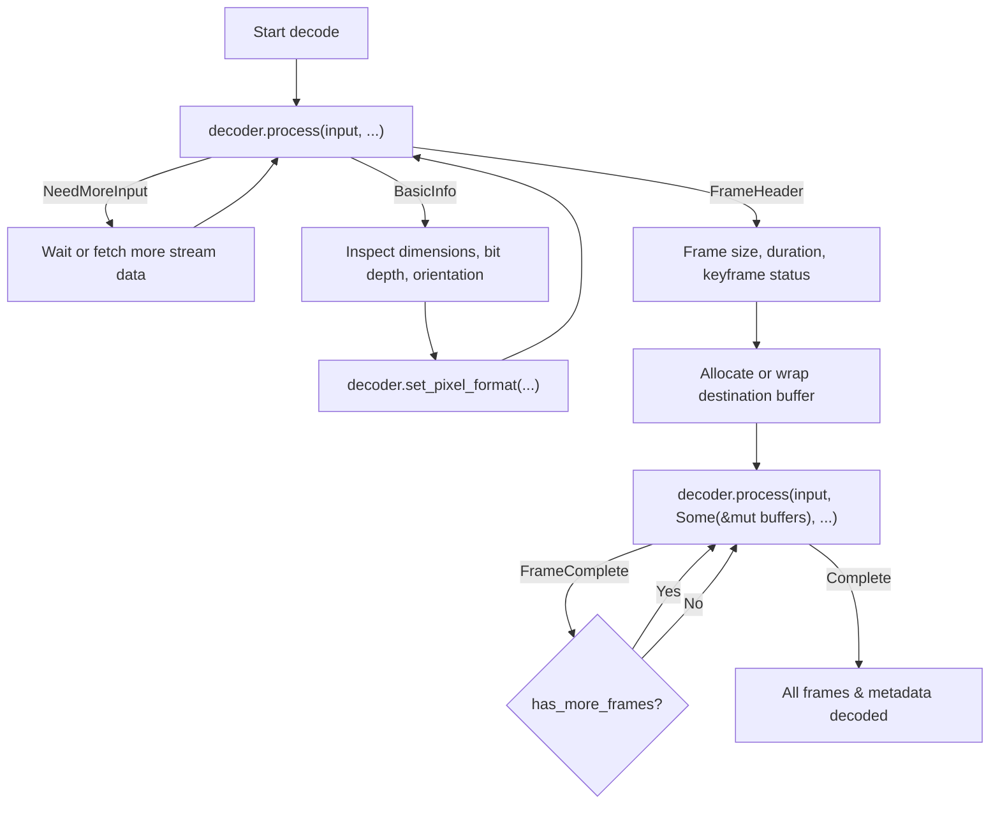

# Research: jxl-rs Decoder Capabilities and WIC Alignment

## Executive Summary

This research investigates the capabilities, API architecture, pixel formats, color metadata extraction, and concurrency mechanisms of the pure-Rust JPEG XL decoder crate `jxl` ([`libjxl/jxl-rs`](https://github.com/libjxl/jxl-rs)), and defines how these capabilities map directly to the Windows Imaging Component (WIC) decoder subsystem for the `jxlrsWIC` project.

Primary findings:
1. **Input Ingestion**: The `jxl` crate (v0.8.0, 2024 edition) exposes the trait [`jxl::api::JxlBitstreamInput`](https://github.com/libjxl/jxl-rs/blob/main/jxl/src/api/input.rs). Built-in implementations exist for in-memory slices (`&[u8]`) and seekable buffered streams (`BufReader<R: Read + Seek>`). For WIC COM streams, an adapter implementing `JxlBitstreamInput` on top of Windows `IStream` can be constructed straightforwardly with vectored reads and byte skipping.
2. **Output Pixel Layouts & Direct Strides**: The decoder supports interleaved raster outputs via `JxlPixelFormat` across all standard color types (`Bgra`, `Bgr`, `Rgba`, `Rgb`, `Grayscale`, `GrayscaleAlpha`, `Cmyk`) and data bit depths (`U8`, `U16`, `F16`, `F32`, `Custom`). The [`JxlOutputBuffer::new_with_stride`](https://github.com/libjxl/jxl-rs/blob/main/jxl/src/image/output_buffer.rs) API supports arbitrary row stride (pitch), enabling zero-copy decoding directly into caller-provided WIC `CopyPixels` destination buffers.
3. **Color Profiles & CICP**: The decoder extracts both embedded ICC profile streams and structured color encodings via [`jxl::api::JxlColorProfile`](https://github.com/libjxl/jxl-rs/blob/main/jxl/src/api/color.rs). For structured profiles (e.g. sRGB, Display P3, Rec.2100 PQ/HLG), the crate can synthesize valid ICC profile bytes on demand via `try_as_icc(intensity_target)`, which can be fed directly to WIC's `IWICColorContext::InitializeFromMemory`. The structured descriptors also map 1:1 to ITU-T H.273 / ISO/IEC 23091-2 CICP code points.
4. **Threading & SIMD Safety**: Multithreading is decoupled through the [`JxlParallelRunner`](https://github.com/libjxl/jxl-rs/blob/main/jxl/src/api/mod.rs) trait. When passed `None`, decoding runs synchronously on the calling thread (safe for COM apartment models). Multithreaded execution can be enabled via Rayon or the Windows Thread Pool API. SIMD vectorization is handled in `jxl_simd` using dynamic runtime CPU feature detection across SSE4.2, AVX, AVX-512, and ARM Neon. Crucially, the core `jxl` crate enforces `#![deny(unsafe_code)]`.

---

## 1. Primary Sources & Specifications

| Source | Reference / Version | Scope & Authority |
|---|---|---|
| **Crate `jxl`** | `0.8.0` (Edition 2024, BSD-3-Clause) | Official Rust JPEG XL decoder developed by JPEG XL Project Authors ([`libjxl/jxl-rs`](https://github.com/libjxl/jxl-rs)). Used in Chromium and Firefox. |
| **Crate `jxl_simd`** | `0.8.0` (Edition 2024, BSD-3-Clause) | Vectorized kernel subsystem for `jxl-rs` supporting dynamic runtime instruction set selection. |
| **ISO/IEC 18181-1:2024** | JPEG XL Image Coding System — Part 1: Core coding system | Bitstream format, frame headers, modular/VarDCT mode definitions, color spaces, extra channels. |
| **ISO/IEC 18181-2:2024** | JPEG XL Image Coding System — Part 2: File format | ISO-BMFF container (`.jxl`), box parsing (`JXL `, `ftyp`, `jxlc`, `jxlp`, `jxli`, `Exif`, `xml `). |
| **ITU-T H.273 / ISO/IEC 23091-2** | Coding-independent code points (CICP) | Primaries, transfer characteristics, matrix coefficients for video and still images. |
| **Windows Imaging Component (WIC)** | Microsoft Win32 API (`wincodec.h`, `windows` crate) | `IWICBitmapDecoder`, `IWICBitmapFrameDecode`, `IWICColorContext`, `IWICPalette`, pixel format GUIDs. |

---

## 2. Input Ingestion Architecture

### 2.1 The `JxlBitstreamInput` Trait

In `jxl` v0.8.0, input streaming is unified under `jxl::api::JxlBitstreamInput`:

```rust
pub trait JxlBitstreamInput {
    /// Returns an estimate bound of the total number of bytes that can be read via `read`.
    /// Returning a too-low estimate can impede parallelism. Returning a too-high
    /// estimate can increase memory usage.
    fn available_bytes(&mut self) -> Result<usize, std::io::Error>;

    /// Fills in `bufs` with more bytes, returning the number of bytes written.
    /// Buffers are filled in order and to completion.
    fn read(&mut self, bufs: &mut [std::io::IoSliceMut]) -> Result<usize, std::io::Error>;

    /// Skips up to `bytes` bytes of input.
    /// Returns the number of bytes that were skipped.
    fn skip(&mut self, bytes: usize) -> Result<usize, std::io::Error> {
        // Default implementation reads into a scratch buffer and discards.
    }
}
```

### 2.2 Built-in Implementations

1. **In-Memory Slice (`&[u8]`)**:
   ```rust
   impl JxlBitstreamInput for &[u8] {
       fn available_bytes(&mut self) -> Result<usize, std::io::Error> {
           Ok(self.len())
       }
       fn read(&mut self, bufs: &mut [std::io::IoSliceMut]) -> Result<usize, std::io::Error> {
           self.read_vectored(bufs)
       }
       fn skip(&mut self, bytes: usize) -> Result<usize, std::io::Error> {
           let num = bytes.min(self.len());
           self.consume(num);
           Ok(num)
       }
   }
   ```
2. **Seekable Streams (`std::io::BufReader<R: Read + Seek>`)**:
   ```rust
   impl<R: Read + Seek> JxlBitstreamInput for BufReader<R> {
       fn available_bytes(&mut self) -> Result<usize, std::io::Error> {
           let pos = self.stream_position()?;
           let end = self.seek(SeekFrom::End(0))?;
           self.seek(SeekFrom::Start(pos))?;
           Ok(end.saturating_sub(pos) as usize)
       }
       fn read(&mut self, bufs: &mut [IoSliceMut]) -> Result<usize, std::io::Error> {
           self.read_vectored(bufs)
       }
       fn skip(&mut self, bytes: usize) -> Result<usize, std::io::Error> {
           let cur = self.stream_position()?;
           if let Ok(offset) = i64::try_from(bytes) {
               self.seek(SeekFrom::Current(offset)).map(|x| x.saturating_sub(cur) as usize)
           } else {
               self.seek(SeekFrom::End(0)).map(|x| x.saturating_sub(cur) as usize)
           }
       }
   }
   ```

### 2.3 Adaptation for WIC COM Streams (`IStream`)

In Windows COM, `IWICBitmapDecoder::Initialize` provides an `IStream` pointer (`windows::Win32::System::Com::IStream`). To feed `IStream` into `JxlDecoder`, we implement `JxlBitstreamInput` on an `IStreamAdapter`:

```rust
use std::io::{Error, ErrorKind, IoSliceMut};
use windows::Win32::System::Com::{IStream, STREAM_SEEK_CUR, STREAM_SEEK_END, STREAM_SEEK_SET, STATFLAG_NONAME};

pub struct ComStreamInput<'a> {
    stream: &'a IStream,
}

impl<'a> ComStreamInput<'a> {
    pub fn new(stream: &'a IStream) -> Self {
        Self { stream }
    }
}

impl<'a> jxl::api::JxlBitstreamInput for ComStreamInput<'a> {
    fn available_bytes(&mut self) -> Result<usize, Error> {
        unsafe {
            let mut stat = std::mem::zeroed();
            self.stream.Stat(&mut stat, STATFLAG_NONAME.0 as u32)
                .map_err(|e| Error::new(ErrorKind::Other, e.to_string()))?;
            let total_size = stat.cbSize as u64;

            let mut cur_pos = 0u64;
            self.stream.Seek(0, STREAM_SEEK_CUR, Some(&mut cur_pos))
                .map_err(|e| Error::new(ErrorKind::Other, e.to_string()))?;

            Ok(total_size.saturating_sub(cur_pos) as usize)
        }
    }

    fn read(&mut self, bufs: &mut [IoSliceMut]) -> Result<usize, Error> {
        let mut total_read = 0;
        for buf in bufs {
            if buf.is_empty() {
                continue;
            }
            let mut bytes_read = 0u32;
            let hr = unsafe {
                self.stream.Read(
                    buf.as_mut_ptr().cast(),
                    buf.len() as u32,
                    Some(&mut bytes_read),
                )
            };
            if let Err(e) = hr {
                return Err(Error::new(ErrorKind::Other, e.to_string()));
            }
            total_read += bytes_read as usize;
            if (bytes_read as usize) < buf.len() {
                break; // End of stream or partial read
            }
        }
        Ok(total_read)
    }

    fn skip(&mut self, bytes: usize) -> Result<usize, Error> {
        unsafe {
            let mut cur_pos = 0u64;
            self.stream.Seek(0, STREAM_SEEK_CUR, Some(&mut cur_pos))
                .map_err(|e| Error::new(ErrorKind::Other, e.to_string()))?;
            let mut new_pos = 0u64;
            self.stream.Seek(bytes as i64, STREAM_SEEK_CUR, Some(&mut new_pos))
                .map_err(|e| Error::new(ErrorKind::Other, e.to_string()))?;
            Ok(new_pos.saturating_sub(cur_pos) as usize)
        }
    }
}
```

### 2.4 Event-Driven Streaming Decode Loop

`JxlDecoder::process` operates as a cooperative state machine:
```rust
pub fn process(
    &mut self,
    input: &mut dyn JxlBitstreamInput,
    buffers: Option<&mut [JxlOutputBuffer]>,
    parallel_runner: Option<&mut (dyn JxlParallelRunner + '_)>,
) -> Result<Event>
```

Emitted `Event` progression:


---

## 3. Output Pixel Formats & Buffer Architecture

### 3.1 Color Types & Data Formats

The `jxl` API specifies output raster formatting via `JxlPixelFormat`:

```rust
pub struct JxlPixelFormat {
    pub color_type: JxlColorType,
    pub color_data_format: Option<JxlDataFormat>,
    pub extra_channel_format: Vec<Option<JxlDataFormat>>,
}
```

#### `JxlColorType`
* `Grayscale` (1 sample/pixel)
* `GrayscaleAlpha` (2 samples/pixel)
* `Rgb` (3 samples/pixel: R, G, B)
* `Rgba` (4 samples/pixel: R, G, B, A)
* `Bgr` (3 samples/pixel: B, G, R)
* `Bgra` (4 samples/pixel: B, G, R, A) — **Native match for standard Windows 32bpp GDI/D2D/WIC layouts**
* `Cmyk` (4 samples/pixel: C, M, Y, K)

#### `JxlDataFormat`
* `U8 { bit_depth: u8 }`: Unsigned integer 1..=8 bits (standard 8bpc).
* `U16 { endianness: Endianness, bit_depth: u8 }`: Unsigned integer 1..=16 bits (standard 16bpc, `Endianness::native()`).
* `F16 { endianness: Endianness }`: IEEE 754 half-precision float (16-bit float, native HDR format for DirectX/WIC).
* `F32 { endianness: Endianness }`: IEEE 754 single-precision float (32-bit float).
* `Custom { bytes_per_pixel: u8 }`: User-supplied callback receiving planar `f32` slices for custom color transforms.

### 3.2 Alpha Channel Handling

JPEG XL supports both associated (premultiplied) and unassociated (straight) alpha. In `jxl-rs`, alpha behavior is configured via `JxlDecoderOptions::alpha_mode`:

```rust
pub enum AlphaMode {
    /// Output color channels as encoded in codestream (no conversion).
    AsIs,
    /// Multiplies RGB by alpha if codestream alpha is unassociated.
    Premultiplied,
    /// Divides RGB by alpha if codestream alpha is associated.
    Unpremultiplied,
}
```

This maps directly to WIC conventions:
* Straight alpha (`GUID_WICPixelFormat32bppBGRA`, `GUID_WICPixelFormat64bppRGBA`, `GUID_WICPixelFormat64bppRGBAHalf`): Use `AlphaMode::Unpremultiplied`.
* Premultiplied alpha (`GUID_WICPixelFormat32bppPBGRA`, `GUID_WICPixelFormat64bppPRGBA`, `GUID_WICPixelFormat64bppPRGBAHalf`): Use `AlphaMode::Premultiplied`.

### 3.3 Zero-Copy Raster Decoding into WIC Caller Buffers

In `IWICBitmapFrameDecode::CopyPixels`:
```cpp
HRESULT CopyPixels(
    const WICRect *prc,
    UINT cbStride,
    UINT cbBufferSize,
    BYTE *pbBuffer
);
```

The caller provides an arbitrary destination row pitch (`cbStride`), pointer (`pbBuffer`), and size (`cbBufferSize`). 

In `jxl-rs`, [`JxlOutputBuffer`](https://github.com/libjxl/jxl-rs/blob/main/jxl/src/image/output_buffer.rs) provides two constructors tailored for strided memory:
```rust
// Safe slice constructor:
pub fn new_with_stride(
    buf: &'a mut [u8],
    num_rows: usize,
    bytes_per_row: usize,
    byte_stride: usize,
) -> Self;

// Raw pointer constructor:
pub unsafe fn new_from_ptr(
    buf: *mut u8,
    num_rows: usize,
    bytes_per_row: usize,
    bytes_between_rows: usize,
) -> Self;
```

**Memory alignment**: `jxl` recommends 2-byte alignment for u16/f16 and 4-byte alignment for f32. Standard WIC callers (Direct2D, Explorer) align rows to at least 4 bytes.

---

## 4. Color Metadata & Profile Extraction

### 4.1 Structure of `JxlColorProfile`

In `jxl::api::color`:
```rust
pub enum JxlColorProfile {
    Icc(Vec<u8>),
    Simple(JxlColorEncoding),
}
```

JPEG XL files can encode color in two forms:
1. **Embedded ICC profile** (`JxlColorProfile::Icc`): Raw ICC profile bytes stored in an `iccp` box or codestream header.
2. **Simple/Structured color encoding** (`JxlColorProfile::Simple`): Compact parametric definition containing:
   - `white_point`: `D65`, `E`, `DCI`, or custom chromaticity `(wx, wy)`
   - `primaries`: `SRGB`, `BT2100` (Rec.2020), `P3`, or custom chromaticities `(rx, ry, gx, gy, bx, by)`
   - `transfer_function`: `BT709`, `Linear`, `SRGB`, `PQ`, `DCI`, `HLG`, or `Gamma(f32)`
   - `rendering_intent`: `Perceptual`, `Relative`, `Saturation`, `Absolute`

### 4.2 Synthesizing ICC Profiles for WIC

WIC exposes image color metadata through `IWICColorContext`. An `IWICColorContext` is initialized with raw ICC bytes:
```rust
// IWICColorContext::InitializeFromMemory
unsafe {
    p_color_context.InitializeFromMemory(icc_bytes.as_ptr(), icc_bytes.len() as u32)?;
}
```

The `jxl` crate provides the method `try_as_icc(intensity_target)` on `JxlColorProfile`:
```rust
pub fn try_as_icc(&self, intensity_target: f32) -> Option<Cow<'_, Vec<u8>>> {
    match self {
        Self::Icc(x) => Some(Cow::Borrowed(x)),
        Self::Simple(encoding) => encoding
            .maybe_create_profile(intensity_target)
            .ok()
            .flatten()
            .map(Cow::Owned),
    }
}
```
* **Embedded ICC**: Returns `Cow::Borrowed(x)` (zero copy).
* **Simple Structured Profile**: Synthesizes a valid ICC profile (e.g. sRGB, Display P3, Rec.2020 PQ/HLG) calibrated to the image's `intensity_target` (from `decoder.basic_info().unwrap().tone_mapping.intensity_target`).

### 4.3 Direct Mapping to ITU-T H.273 CICP

For Windows Advanced Color / Direct2D HDR metadata pipelines, structured color descriptors can be mapped directly to CICP code points:

| JXL Descriptor | CICP Primaries | CICP Transfer Characteristics | CICP Matrix | Range |
|---|---|---|---|---|
| **sRGB** (`primaries: SRGB`, `tf: SRGB`) | `1` (BT.709/sRGB) | `13` (IEC 61966-2-1 sRGB) | `0` (Identity / RGB) | `1` (Full) |
| **Linear sRGB** (`primaries: SRGB`, `tf: Linear`) | `1` (BT.709/sRGB) | `8` (Linear) | `0` (Identity / RGB) | `1` (Full) |
| **Display P3** (`primaries: P3`, `tf: SRGB`) | `12` (P3-D65) | `13` (IEC 61966-2-1 sRGB) | `0` (Identity / RGB) | `1` (Full) |
| **Rec.2020 PQ** (`primaries: BT2100`, `tf: PQ`) | `9` (BT.2020/2100) | `16` (SMPTE ST 2084 / PQ) | `0` (Identity / RGB) | `1` (Full) |
| **Rec.2020 HLG** (`primaries: BT2100`, `tf: HLG`) | `9` (BT.2020/2100) | `18` (ARIB STD-B67 / HLG) | `0` (Identity / RGB) | `1` (Full) |

---

## 5. Concurrency & SIMD Vectorization

### 5.1 Concurrency Model (`JxlParallelRunner`)

Multithreading in `jxl` is completely decoupled via dependency injection:
```rust
pub type JxlParallelRunnerFun<'a> = dyn Fn(usize) -> Result<()> + Sync + 'a;

pub trait JxlParallelRunner {
    fn run(&mut self, num: usize, fun: &JxlParallelRunnerFun<'_>) -> Result<()>;
    fn num_threads(&self) -> usize;
    fn run_ordered(&mut self, num: usize, max_threads: Option<usize>, fun: &JxlParallelRunnerFun<'_>) -> Result<()>;
}
```

#### COM Apartment Concurrency Implications
* In a WIC in-process COM server (`cdylib`), client hosts (such as Windows Explorer thumbnail cache or Windows Photo Viewer) frequently invoke decoders on background STA/MTA threads with stringent CPU and thread affinity expectations.
* Passing `None` to `decoder.process(..., None)` uses `SequentialRunner` (`1` thread), running synchronously on the host thread without spawning background thread workers.
* When multithreading is desired, an implementation backed by `rayon` or the Win32 Thread Pool API (`CreateThreadPoolWork`) can be supplied.

```rust
// Example Rayon Runner:
struct RayonParallelRunner;

impl jxl::api::JxlParallelRunner for RayonParallelRunner {
    fn run(&mut self, num: usize, fun: &jxl::api::JxlParallelRunnerFun) -> jxl::error::Result<()> {
        use rayon::iter::{IntoParallelIterator, ParallelIterator};
        (0..num).into_par_iter().try_for_each(fun)
    }

    fn num_threads(&self) -> usize {
        rayon::current_num_threads()
    }
}
```

### 5.2 SIMD Vectorization (`jxl_simd`)

The `jxl_simd` crate compiles optimized kernels for:
* **x86_64**: SSE4.2, AVX, AVX-512
* **aarch64**: ARM Neon
* **wasm32**: SIMD128
* **scalar**: Generic portable fallback

**Dynamic CPU Dispatch**:
The crate uses dynamic runtime CPU feature detection (`SimdDescriptor::new()`). The binary contains all compiled SIMD paths, and dispatches to the highest available instruction set on the user's host CPU at runtime without crashing older hardware.

**Safety & Verification**:
The crate root of `jxl` contains:
```rust
#![deny(unsafe_code)]
```
All unsafe operations for vector intrinsics and pointer offsets are strictly isolated inside `jxl_simd` and `jxl::image::output_buffer`, with safety documentation and bounds verification enforced by clippy lints (`workspace.lints.clippy.undocumented_unsafe_blocks = "deny"`).

---

## 6. Comprehensive Mapping Matrix: JXL to WIC Pixel Formats

The following matrix maps standard Windows Imaging Component GUIDs to `jxl` configurations:

| Standard WIC Pixel Format GUID | Description | `JxlColorType` | `JxlDataFormat` | `AlphaMode` | Bits/Pixel | Typical Host Consumer |
|---|---|---|---|---|---|---|
| `GUID_WICPixelFormat32bppBGRA` | 8bpc Blue-Green-Red-Alpha (Straight) | `Bgra` | `U8 { bit_depth: 8 }` | `Unpremultiplied` | 32 | Windows Explorer, GDI, Direct2D Default |
| `GUID_WICPixelFormat32bppPBGRA` | 8bpc Blue-Green-Red-Alpha (Premultiplied) | `Bgra` | `U8 { bit_depth: 8 }` | `Premultiplied` | 32 | Direct2D / DirectWrite composition |
| `GUID_WICPixelFormat32bppRGBA` | 8bpc Red-Green-Blue-Alpha (Straight) | `Rgba` | `U8 { bit_depth: 8 }` | `Unpremultiplied` | 32 | Direct3D textures, OpenGL, Vulkan |
| `GUID_WICPixelFormat32bppPRGBA` | 8bpc Red-Green-Blue-Alpha (Premultiplied) | `Rgba` | `U8 { bit_depth: 8 }` | `Premultiplied` | 32 | Direct3D alpha blending |
| `GUID_WICPixelFormat24bppBGR` | 8bpc Blue-Green-Red (No alpha) | `Bgr` | `U8 { bit_depth: 8 }` | `AsIs` | 24 | Legacy Windows DIB / BMP |
| `GUID_WICPixelFormat24bppRGB` | 8bpc Red-Green-Blue (No alpha) | `Rgb` | `U8 { bit_depth: 8 }` | `AsIs` | 24 | Standard 24-bit RGB |
| `GUID_WICPixelFormat64bppRGBA` | 16bpc Red-Green-Blue-Alpha (Straight) | `Rgba` | `U16 { endianness: Native, bit_depth: 16 }` | `Unpremultiplied` | 64 | High bit-depth raster editing |
| `GUID_WICPixelFormat64bppPRGBA` | 16bpc Red-Green-Blue-Alpha (Premultiplied) | `Rgba` | `U16 { endianness: Native, bit_depth: 16 }` | `Premultiplied` | 64 | High-precision Direct2D pipeline |
| `GUID_WICPixelFormat48bppRGB` | 16bpc Red-Green-Blue (No alpha) | `Rgb` | `U16 { endianness: Native, bit_depth: 16 }` | `AsIs` | 48 | High bit-depth photo storage |
| `GUID_WICPixelFormat64bppRGBAHalf` | 16bpc FP16 Half-float RGBA (Straight) | `Rgba` | `F16 { endianness: Native }` | `Unpremultiplied` | 64 | Direct3D HDR10 / scRGB swapchains |
| `GUID_WICPixelFormat64bppPRGBAHalf` | 16bpc FP16 Half-float RGBA (Premultiplied) | `Rgba` | `F16 { endianness: Native }` | `Premultiplied` | 64 | Windows Advanced Color composition |
| `GUID_WICPixelFormat128bppRGBAFloat` | 32bpc FP32 Single-float RGBA (Straight) | `Rgba` | `F32 { endianness: Native }` | `Unpremultiplied` | 128 | High Dynamic Range VFX / OpenEXR |
| `GUID_WICPixelFormat128bppPRGBAFloat` | 32bpc FP32 Single-float RGBA (Premultiplied) | `Rgba` | `F32 { endianness: Native }` | `Premultiplied` | 128 | Float compositing pipeline |
| `GUID_WICPixelFormat8bppGray` | 8bpc Grayscale | `Grayscale` | `U8 { bit_depth: 8 }` | `AsIs` | 8 | Monochrome / Document images |
| `GUID_WICPixelFormat16bppGray` | 16bpc Grayscale | `Grayscale` | `U16 { endianness: Native, bit_depth: 16 }` | `AsIs` | 16 | Medical imaging (DICOM) / High-depth Gray |
| `GUID_WICPixelFormat16bppGrayHalf` | 16bpc FP16 Half-float Grayscale | `Grayscale` | `F16 { endianness: Native }` | `AsIs` | 16 | HDR luminance masks |
| `GUID_WICPixelFormat32bppGrayFloat` | 32bpc FP32 Single-float Grayscale | `Grayscale` | `F32 { endianness: Native }` | `AsIs` | 32 | Scientific grayscale / depth maps |
| `GUID_WICPixelFormat32bppCMYK` | 8bpc Cyan-Magenta-Yellow-Black | `Cmyk` | `U8 { bit_depth: 8 }` | `AsIs` | 32 | Print / Prepress CMYK JPEG XL |

---

## 7. Architectural Recommendations for the Decoder Seam (Issue #6)

1. **Native Preference Order**:
   - For standard SDR color images: Negotiate `GUID_WICPixelFormat32bppBGRA` as default. Because `JxlColorType::Bgra` is a first-class variant in `jxl-rs`, rendering directly into 32bpp BGRA avoids any post-decode swizzling or color conversion step.
   - For HDR / Wide Gamut images (bit depth > 8 or tone mapping intensity target > 255 nits): Prefer `GUID_WICPixelFormat64bppRGBAHalf` (FP16). Direct3D and Direct2D use FP16 for scRGB HDR surfaces on Windows 10/11.
   - For grayscale images: Negotiate `GUID_WICPixelFormat8bppGray` (8-bit) or `GUID_WICPixelFormat16bppGray` (16-bit).
2. **Direct Frame Decode Pipeline**:
   - `IWICBitmapFrameDecode::GetPixelFormat` returns the native format selected based on `JxlBasicInfo`.
   - In `IWICBitmapFrameDecode::CopyPixels`:
     - If the caller requests a sub-rectangle `prc` or multiple disjoint reads, cache the decoded frame raster in memory upon first decode.
     - For single full-image reads matching the native format, wrap `pbBuffer` with `JxlOutputBuffer::new_with_stride` and decode directly into the caller's memory.
3. **Color Context Propagation**:
   - In `IWICBitmapFrameDecode::GetColorContexts`:
     - Query `decoder.embedded_color_profile()`.
     - Call `try_as_icc(basic_info.tone_mapping.intensity_target)`.
     - Allocate an `IWICColorContext` via `IWICImagingFactory::CreateColorContext` and call `InitializeFromMemory`.
4. **Orientation Handling**:
   - `JxlDecoderOptions::adjust_orientation` defaults to `true`. This causes `basic_info.size` to automatically report the oriented dimensions and outputs rows in display order.
   - WIC decoders traditionally report the oriented pixel dimensions in `IWICBitmapFrameDecode::GetSize`, meaning setting `adjust_orientation: true` satisfies standard Windows application expectations without custom EXIF rotation transforms.
